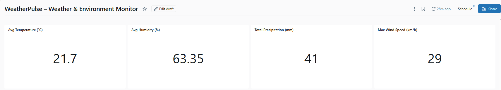
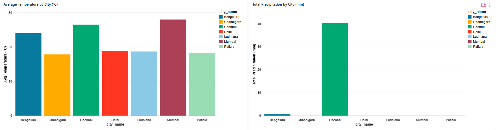
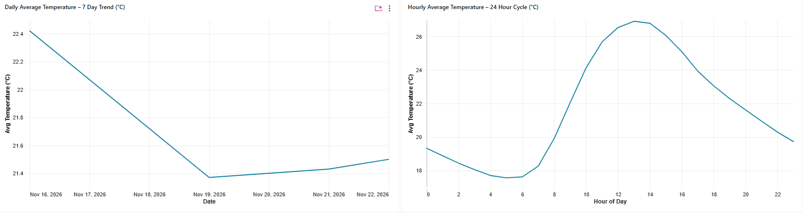
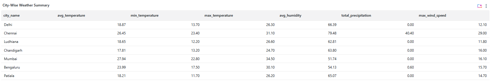

# 🌦️ WeatherPulse – Weather & Environment Monitor

WeatherPulse is a data engineering project that collects, processes, stores, and analyzes weather forecast data for seven Indian cities using the Open-Meteo Forecast API.

It provides a React-based interactive dashboard powered by a FastAPI backend and SQLite Gold Layer.

## 🚀 Project Overview

WeatherPulse monitors weather conditions across:

- Delhi
- Mumbai
- Chandigarh
- Bengaluru
- Ludhiana
- Patiala
- Chennai

The application collects hourly weather forecasts for seven days and transforms them into structured analytical datasets.

## ✨ Key Features

### 1. API Data Ingestion
- Fetches hourly weather forecasts from Open-Meteo.
- Collects temperature, humidity, precipitation, and wind speed.
- Implements retry and backoff mechanisms.
- Saves raw API responses as JSON files.

### 2. Data Validation
- Validates JSON structure.
- Checks required fields.
- Verifies hourly array lengths.
- Detects missing values.

### 3. Normalized Database
Implements a relational database design with:

- locations
- ingestion_runs
- weather_forecasts

Includes primary keys, foreign keys, constraints, indexes, and deduplication.

### 4. Star Schema
Implements a dimensional model consisting of:

- dim_location
- dim_date
- dim_time
- fact_weather

### 5. Medallion Architecture

The project organizes data into analytical layers:

- Bronze: Raw API JSON data.
- Silver: Validated and normalized weather records.
- Gold: Analytical views and reporting datasets.

### 6. SQL Analytics
Includes analytical queries for:

- Average temperature by city.
- Maximum and minimum temperatures.
- Total precipitation.
- Maximum wind speed.
- Average humidity.
- Daily and hourly weather trends.

### 7. Databricks & Delta Lake Integration

Implemented a cloud-based Medallion Architecture using Databricks Free Edition, PySpark and Delta Lake.

- Bronze Layer: Stores raw weather API JSON data.
- Silver Layer: Flattens hourly weather arrays into 1,176 structured records and performs data quality checks.
- Gold Layer: Creates analytical datasets for city-wise, daily and hourly weather analysis.
- Databricks SQL: Queries Gold Layer Delta tables.
- AI/BI Dashboard: Visualizes weather KPIs, city comparisons and temperature trends.

### 8. Interactive Dashboard

Built using React, Vite, Recharts, and Lucide React.

Dashboard features:

- Live weather KPI cards.
- Daily temperature trend chart.
- City-wise rainfall comparison.
- 24-hour temperature analysis.
- Monitored cities overview.
- Detailed city weather table.
- Manual data refresh.

### 9. REST API

Backend developed using FastAPI.

Available endpoints:

| Method | Endpoint | Description |
|---|---|---|
| GET | /api/health | API health check |
| GET | /api/weather/summary | City-wise weather summary |
| GET | /api/weather/daily | Daily weather trends |
| GET | /api/weather/hourly | Hourly weather trends |
| GET | /api/weather/kpis | Dashboard KPIs |

Interactive API documentation is available at `/docs`.

## 🛠️ Technology Stack

| Component | Technologies |
|---|---|
| Programming | Python, JavaScript, SQL |
| API Source | Open-Meteo Forecast API |
| Data Processing | Pandas, PySpark |
| Database | SQLite, Databricks Delta Lake |
| Backend | FastAPI, Uvicorn |
| Frontend | React, Vite |
| Data Engineering | Databricks, Medallion Architecture |
| Analytics & Visualization | Recharts, Databricks AI/BI Dashboard |
| Icons | Lucide React |
| Version Control | Git, GitHub |

## 📁 Project Structure

```text
WeatherPulse/
│
├── databricks/
│   └── WeatherPulse_Medallion_Pipeline.ipynb
│
├── dashboard/
│   ├── public/
│   ├── src/
│   ├── package.json
│   └── vite.config.js
│
├── docs/
│   ├── er_diagram.md
│   ├── deduplication_strategy.md
│   ├── star_schema.md
│   └── screenshots/
│       ├── 01_dashboard_kpi_cards.png
│       ├── 02_city_weather_comparison.png
│       ├── 03_temperature_trends.png
│       └── 04_city_weather_summary.png
│
├── landing_zone/
│   └── Raw JSON weather files
│
├── sql/
│   ├── create_tables.sql
│   ├── analysis_queries.sql
│   ├── create_star_schema.sql
│   └── star_schema_queries.sql
│
├── src/
│   ├── ingest.py
│   ├── validate_data.py
│   ├── create_database.py
│   ├── load_locations.py
│   ├── load_weather_data.py
│   ├── verify_database.py
│   ├── create_star_schema.py
│   ├── load_dimensions.py
│   ├── load_fact_weather.py
│   ├── create_gold_layer.py
│   ├── verify_gold_layer.py
│   ├── run_analysis.py
│   ├── run_star_schema_analysis.py
│   └── api.py
│
├── requirements.txt
├── README.md
└── .gitignore
```

## ⚙️ Installation and Setup

### Prerequisites

- Python 3.12+
- Node.js
- npm
- Git

### 1. Clone Repository

```bash
git clone https://github.com/tannishgarg01/WeatherPulse.git

cd WeatherPulse
```

### 2. Create Python Virtual Environment

```bash
python -m venv .venv
```

Activate on Windows:

```powershell
.venv\Scripts\Activate.ps1
```

### 3. Install Python Dependencies

```bash
pip install -r requirements.txt
```

### 4. Run Data Pipeline

Execute the scripts from the project root in the appropriate order:

```bash
python src/ingest.py
python src/validate_data.py
python src/create_database.py
python src/load_locations.py
python src/load_weather_data.py
python src/verify_database.py
python src/create_star_schema.py
python src/load_dimensions.py
python src/load_fact_weather.py
python src/verify_star_schema.py
python src/create_gold_layer.py
python src/verify_gold_layer.py
```

Run SQL analysis:

```bash
python src/run_analysis.py
python src/run_star_schema_analysis.py
```

### 5. Start FastAPI Backend

```bash
uvicorn src.api:app --reload
```

Backend:

http://127.0.0.1:8000

API documentation:

http://127.0.0.1:8000/docs

### 6. Start React Dashboard

Open another terminal:

```bash
cd dashboard
npm install
npm run dev
```

Dashboard:

http://localhost:5173

## 📊 Data Pipeline

```text
Open-Meteo Forecast API
          |
          v
    Data Ingestion
          |
          v
    Raw JSON Files
          |
          v
    Data Validation
          |
          v
 Normalized SQLite Tables
          |
          v
      Star Schema
          |
          v
     Gold Layer
          |
          v
      FastAPI
          |
          v
    React Dashboard
          |
          v
   Weather Analytics
```

## 📈 Current Dataset

Initial successful ingestion:

| Metric | Records |
|---|---:|
| Cities monitored | 7 |
| Hourly records per city | 168 |
| Total weather records | 1,176 |
| Dimension tables | 3 |
| Fact tables | 1 |
| Gold Layer views | 3 |

## 🔮 Future Enhancements

- Automated scheduled weather data ingestion.
- Cloud deployment of the application.
- Historical weather comparison and forecasting.
- Weather alerts and notifications.
- Advanced geographical visualizations.
- Integration with additional environmental data sources.

## 📊 Databricks Dashboard – WeatherPulse

The WeatherPulse AI/BI Dashboard provides an interactive view of weather conditions across seven Indian cities using Gold Layer Delta tables.

### Dashboard Highlights

- **KPI Cards:** Average Temperature, Average Humidity, Total Precipitation and Maximum Wind Speed.
- **City Comparison:** Average temperature and total precipitation across seven cities.
- **Daily Trends:** 7-day average temperature analysis.
- **Hourly Trends:** 24-hour temperature cycle analysis.
- **City-Wise Summary:** Detailed weather metrics for all monitored cities.

### Dashboard Screenshots

#### 1. Key Performance Indicators


#### 2. City Weather Comparison


#### 3. Daily and Hourly Temperature Trends


#### 4. City-Wise Weather Summary



## 👨‍💻 Author

**Tannish Garg**

B.Tech – Computer Science Engineering (AI)

GitHub: https://github.com/tannishgarg01

## 📜 Data Source

Weather data provided by [Open-Meteo](https://open-meteo.com/).

## 📄 License

This project is developed for educational and academic purposes.