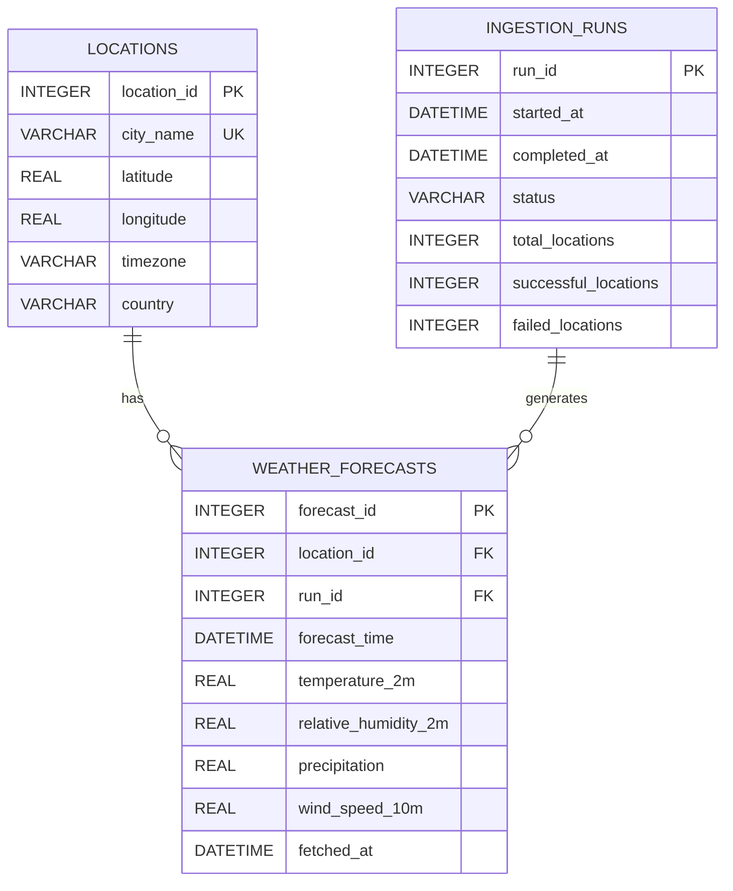

# WeatherPulse - Entity Relationship Diagram

## 1. Project Overview

WeatherPulse is a weather monitoring project that collects
hourly weather forecasts from the Open-Meteo API for seven
Indian cities.

The database follows a normalized relational design based
on Third Normal Form (3NF).

## 2. Database Entities

### A. LOCATIONS

Stores the master information of each monitored city.

| Column | Data Type | Constraint |
|---|---|---|
| location_id | INTEGER | Primary Key |
| city_name | VARCHAR(100) | NOT NULL, UNIQUE |
| latitude | REAL | NOT NULL |
| longitude | REAL | NOT NULL |
| timezone | VARCHAR(100) | NOT NULL |
| country | VARCHAR(100) | NOT NULL |

### B. INGESTION_RUNS

Stores the execution history of API ingestion jobs.

| Column | Data Type | Constraint |
|---|---|---|
| run_id | INTEGER | Primary Key |
| started_at | DATETIME | NOT NULL |
| completed_at | DATETIME | NULL |
| status | VARCHAR(20) | NOT NULL |
| total_locations | INTEGER | NOT NULL |
| successful_locations | INTEGER | NOT NULL |
| failed_locations | INTEGER | NOT NULL |

### C. WEATHER_FORECASTS

Stores hourly weather forecast records for each location.

| Column | Data Type | Constraint |
|---|---|---|
| forecast_id | INTEGER | Primary Key |
| location_id | INTEGER | Foreign Key |
| run_id | INTEGER | Foreign Key |
| forecast_time | DATETIME | NOT NULL |
| temperature_2m | REAL | NULL |
| relative_humidity_2m | REAL | NULL |
| precipitation | REAL | NULL |
| wind_speed_10m | REAL | NULL |
| fetched_at | DATETIME | NOT NULL |

## 3. Entity Relationships

- One location can have many weather forecast records.
- One ingestion run can produce many weather forecast records.
- Every weather forecast belongs to one location.
- Every weather forecast belongs to one ingestion run.

## 4. ER Diagram

## 5. Normalization

### First Normal Form (1NF)
- Every column stores atomic values.
- Hourly weather observations are stored as separate rows.
- No arrays or multiple values are stored in a database cell.

### Second Normal Form (2NF)
- Every table has a primary key.
- Non-key attributes depend on the complete primary key.

### Third Normal Form (3NF)
- Location details are stored separately from weather forecasts.
- Ingestion execution details are stored separately.
- No non-key attribute depends transitively on another non-key attribute.

## 6. Historical Forecast Strategy

WeatherPulse preserves forecast snapshots.

A forecast record is identified logically by:

(location_id, forecast_time, fetched_at)

This allows updated forecasts for the same city and forecast
hour to be stored without deleting earlier snapshots.
